# Lab2Web - Praktikum 2: HTML Lanjutan

| | |
|---|---|
| **Nama** | Erlina Dwi Artika |
| **Kelas** | I252A |
| **NIM** | 312510039 |
| **Mata Kuliah** | Pemrograman Web |

Repository ini berisi hasil Praktikum 2 (HTML Lanjutan): tabel, form dan berbagai jenis input,
semantic HTML, multimedia, dan validasi form dasar.

## Struktur Folder

```
Lab2Web/
├── index.html        # Latihan 1-8 (halaman utama, semantic HTML)
├── biodata.html      # Proyek mini: Form Biodata Mahasiswa
├── media/
│   ├── audio.mp3
│   └── video.mp4
├── screenshots/      # Bukti hasil praktik
└── README.md
```

## Cara Menjalankan

1. Clone / unduh repository ini.
2. Buka `index.html` (atau `biodata.html`) dengan browser, atau gunakan ekstensi Live Server di VS Code.

## Langkah Praktikum

### 1. Tabel Data Mahasiswa
Membuat tabel dengan `<table>`, `<tr>`, `<th>`, `<td>` dan 4 baris data mahasiswa.

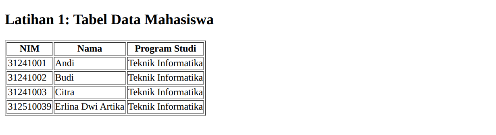

### 2. Tabel dengan thead, tbody, tfoot
Menambahkan `<caption>`, `<thead>`, `<tbody>`, `<tfoot>` dan `colspan="2"` pada baris rata-rata.

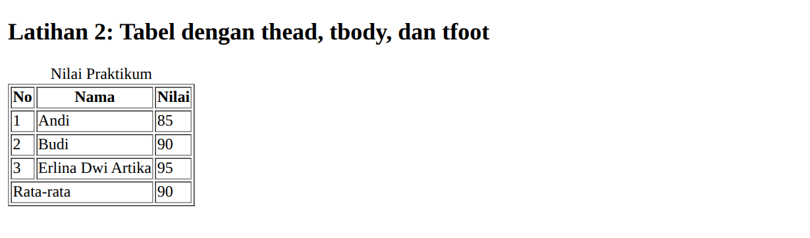

### 3. Form Registrasi Mahasiswa
Input `text`, `email`, `password`, `date`, tombol `submit` dan `reset`, setiap input memiliki `<label for>`.

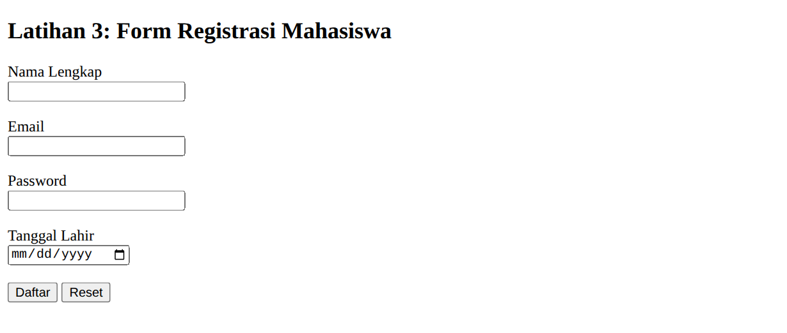

### 4. Radio Button dan Checkbox
Radio `jk` (satu pilihan) dan checkbox `skill` (banyak pilihan).

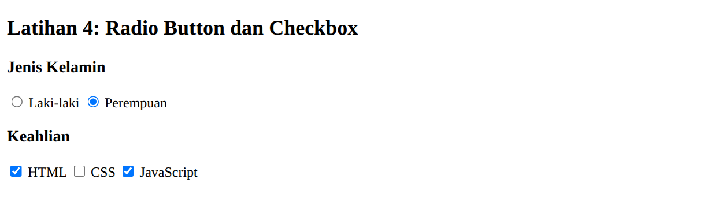

### 5. Select dan Textarea
Dropdown program studi dan kolom alamat multi-baris.

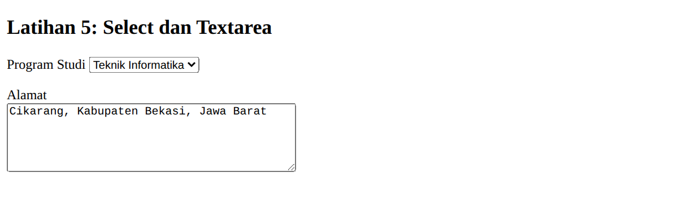

### 6. Validasi Form Dasar
Atribut `required`, `minlength`, `min`, `max`, dan `type="email"`. Pesan validasi muncul saat form tidak valid.

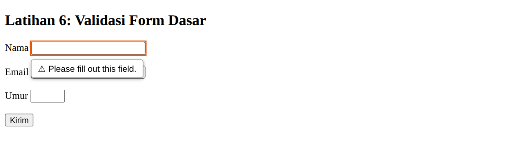
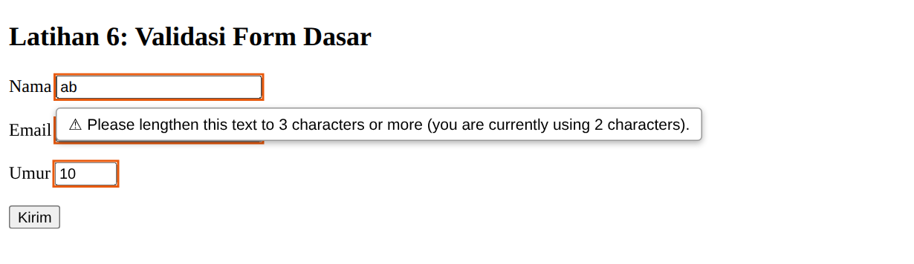
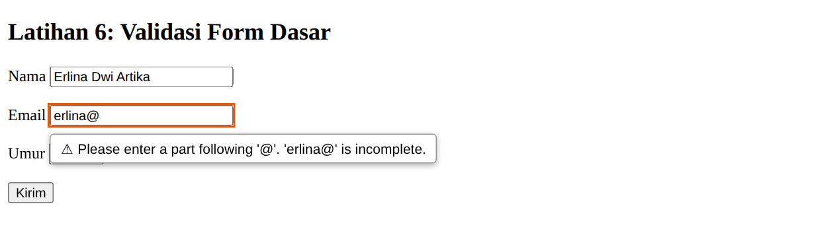
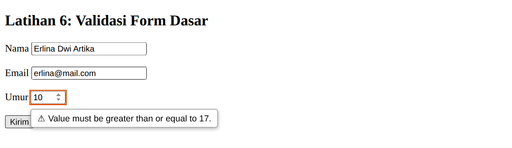

### 7. Semantic HTML
`<header>`, `<nav>`, `<main>`, `<section>`, `<article>`, `<aside>`, `<footer>`.

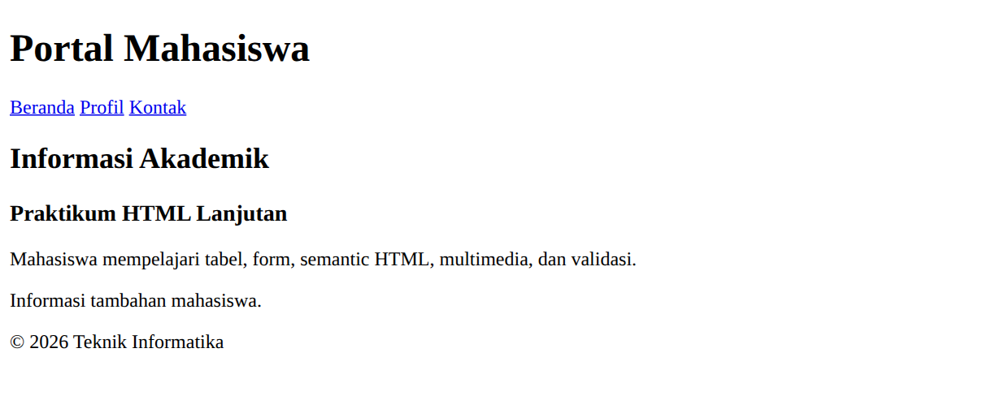

### 8. Multimedia
Elemen `<audio controls>` dan `<video controls>`.

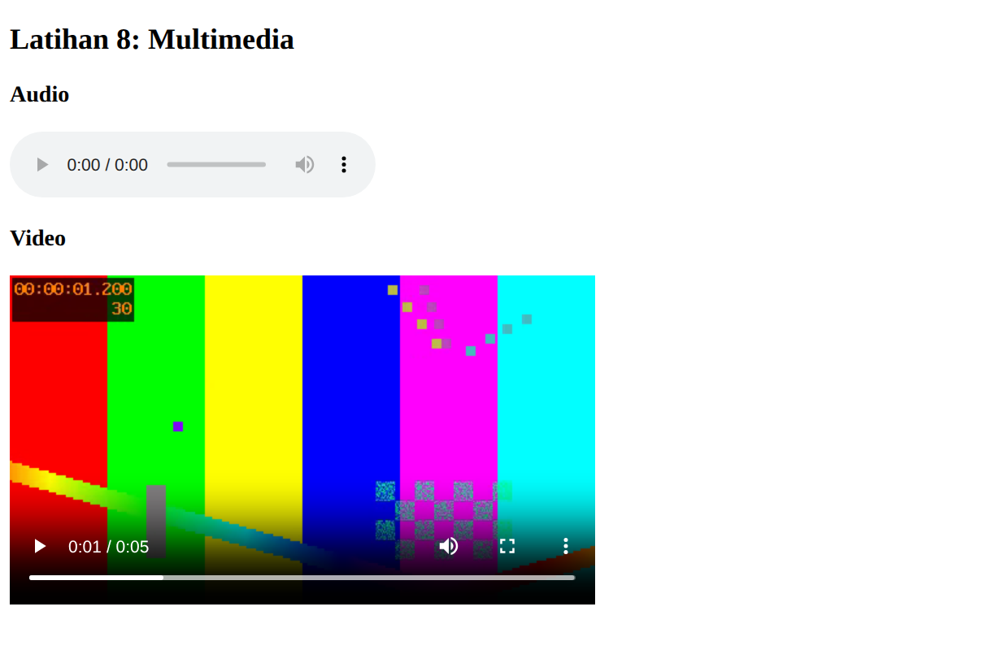

### 9. Proyek Mini: Biodata Mahasiswa (`biodata.html`)
Menggabungkan semantic HTML, tabel, form (text, email, date, radio, select, checkbox, textarea),
validasi dasar, dan satu elemen video.

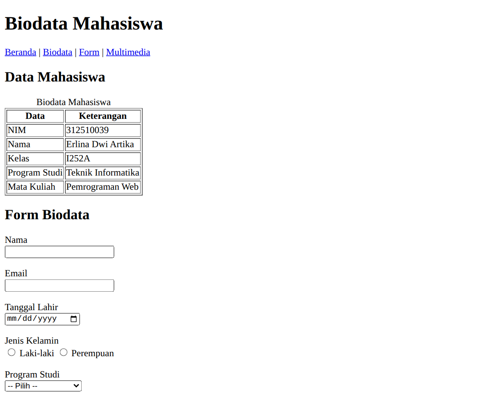
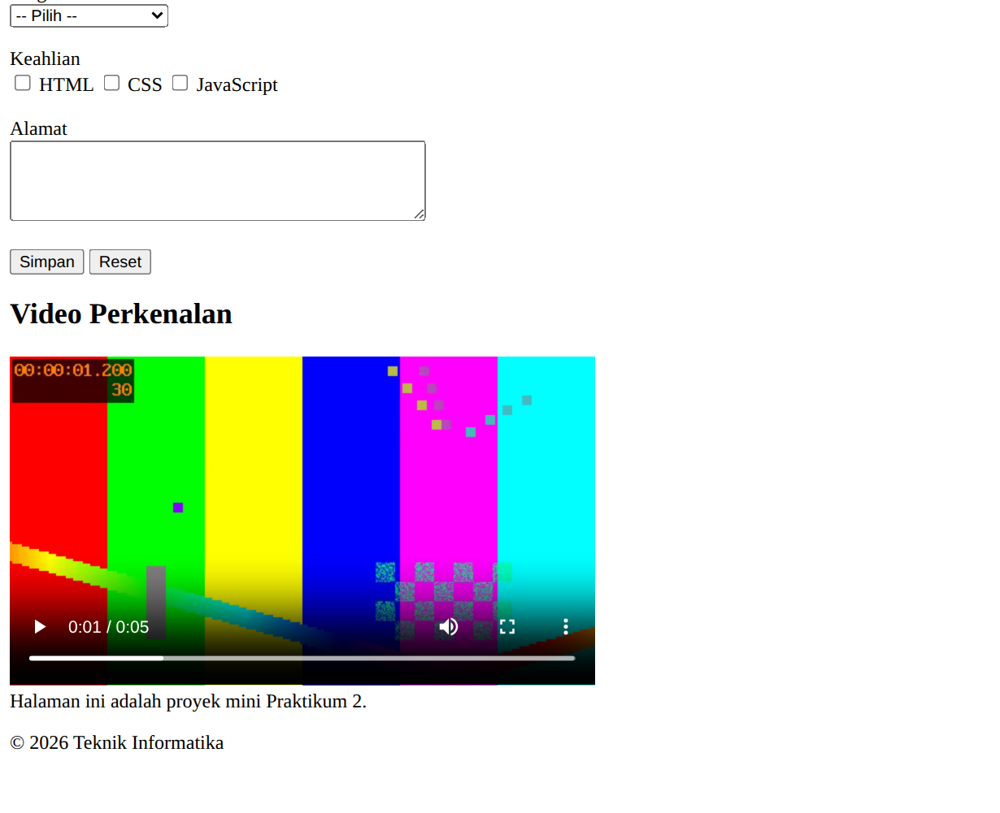
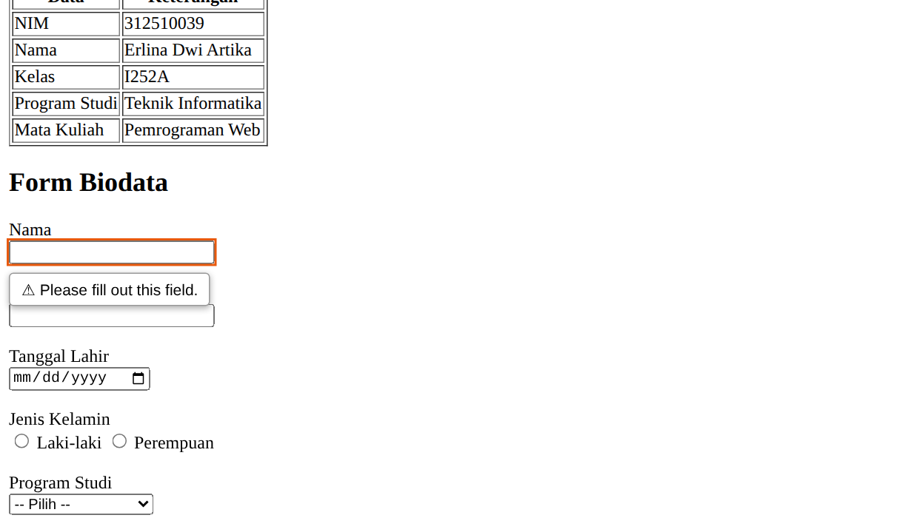

### 10. Halaman Utama Gabungan (`index.html`)

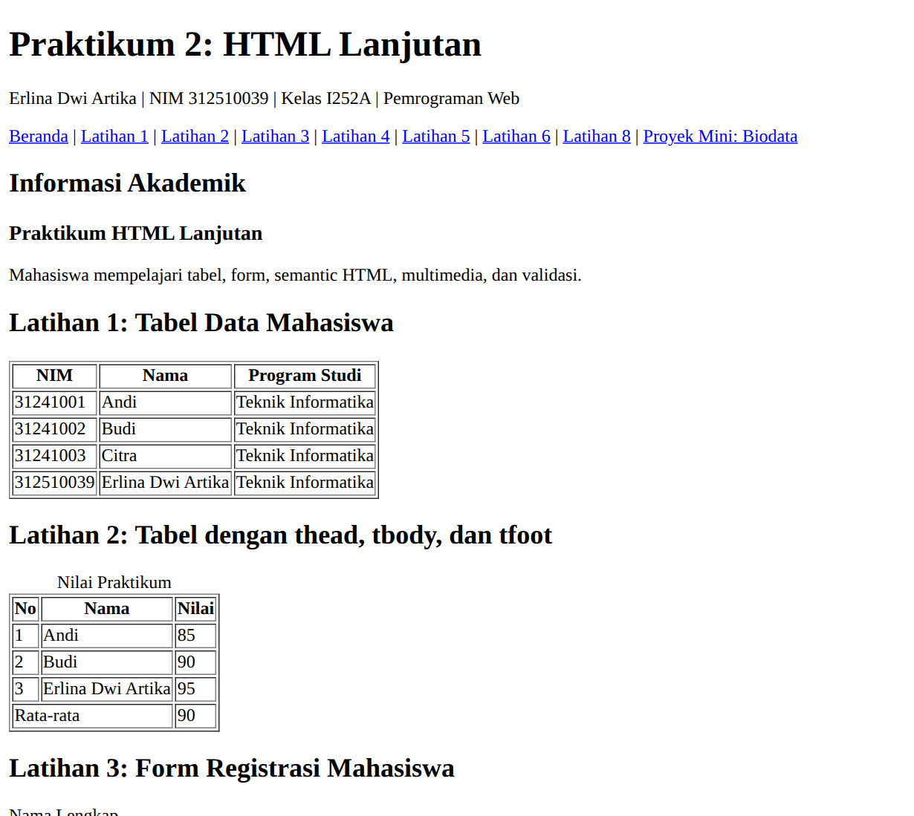
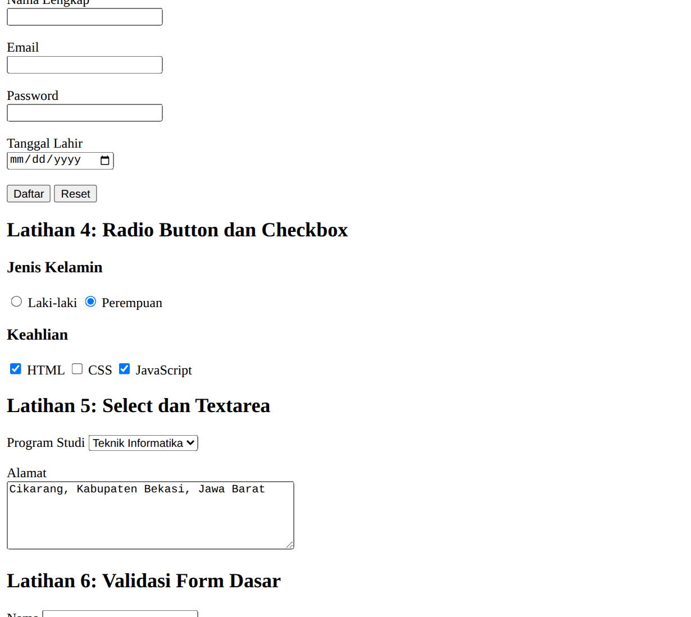
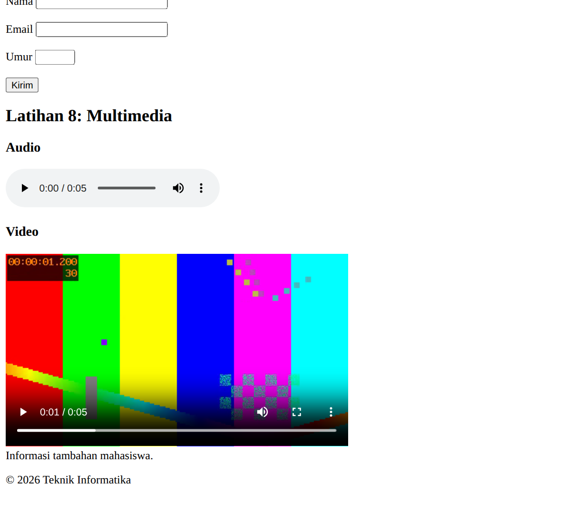
